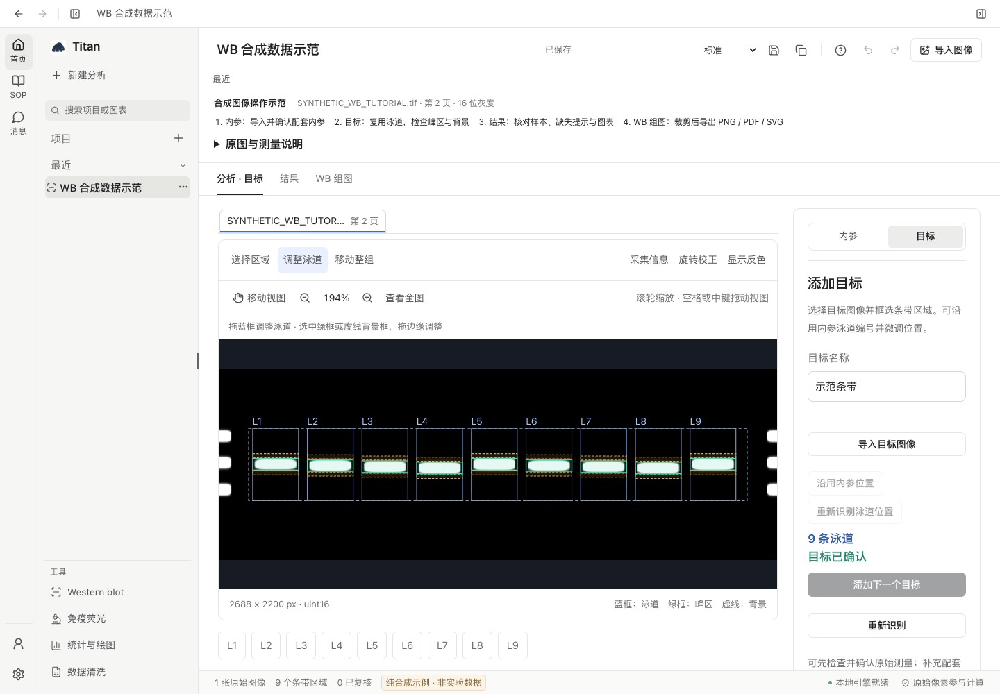

# Titan

Titan 是免费使用的桌面应用，可在本地完成 Western blot 定量与组图、免疫荧光分析、统计绘图和 Excel 数据清洗。分析和项目保存无需登录。

## 下载 Beta

<!-- titan-beta-downloads:start -->
**v0.4.9-beta.1**

**[下载 macOS 版（Apple Silicon）](https://github.com/Goodoweswin/Titan/releases/download/v0.4.9-beta.1/Titan-0.4.9-macos-arm64.dmg)** · **[下载 Windows 版（x64）](https://github.com/Goodoweswin/Titan/releases/download/v0.4.9-beta.1/Titan-0.4.9-windows-x64-setup.exe)**

[版本说明](https://github.com/Goodoweswin/Titan/releases/tag/v0.4.9-beta.1) · [SHA-256 校验](https://github.com/Goodoweswin/Titan/releases/download/v0.4.9-beta.1/SHA256SUMS.txt)
<!-- titan-beta-downloads:end -->

支持 macOS 14+（Apple Silicon）和 Windows 10/11（x64）。[安装、校验与更新](docs/INSTALL.md) · [全部版本](https://github.com/Goodoweswin/Titan/releases)

*Titan 0.4.9 界面的浏览器预览，使用合成数据。*

## 快速开始

安装后，在 Western blot 工具页选择「教程」，用内置合成数据练习目标测量和组图导出。已有自己的实验图时，可从项目中新建 WB 分析。[跟着快速上手操作](docs/QUICKSTART.md)

| 任务 | 使用指南 |
| --- | --- |
| 从内参开始定量、确认目标并导出条带组图 | [Western blot](docs/USER_GUIDE.md) |
| 测量二维荧光强度和阳性面积，制作多通道组图 | [免疫荧光](docs/IF_USER_GUIDE.md) |
| 导入数据或读取项目结果，完成统计与绘图 | [统计与绘图](docs/STATS_USER_GUIDE.md) |
| 在本地核对 Excel 表头、分组、单位和重复记录，再导入统计 | [Excel 数据清洗](docs/QUICKSTART.md#excel-数据清洗) |

## 反馈与许可

- [报告安装、操作或定量问题](https://github.com/Goodoweswin/Titan/issues/new?template=bug_report.yml) · [提出改进建议](https://github.com/Goodoweswin/Titan/issues/new?template=feature_request.yml) · [安全报告](SECURITY.md)
- 已公开的历史源码保留 MIT 授权。新版安装包的许可及第三方声明随安装包分发。GitHub 为新版标签生成的 Source code ZIP/TAR 提供公开发布元数据。 [历史 MIT 源码](https://github.com/Goodoweswin/Titan/tree/v0.4.5-beta.1)
