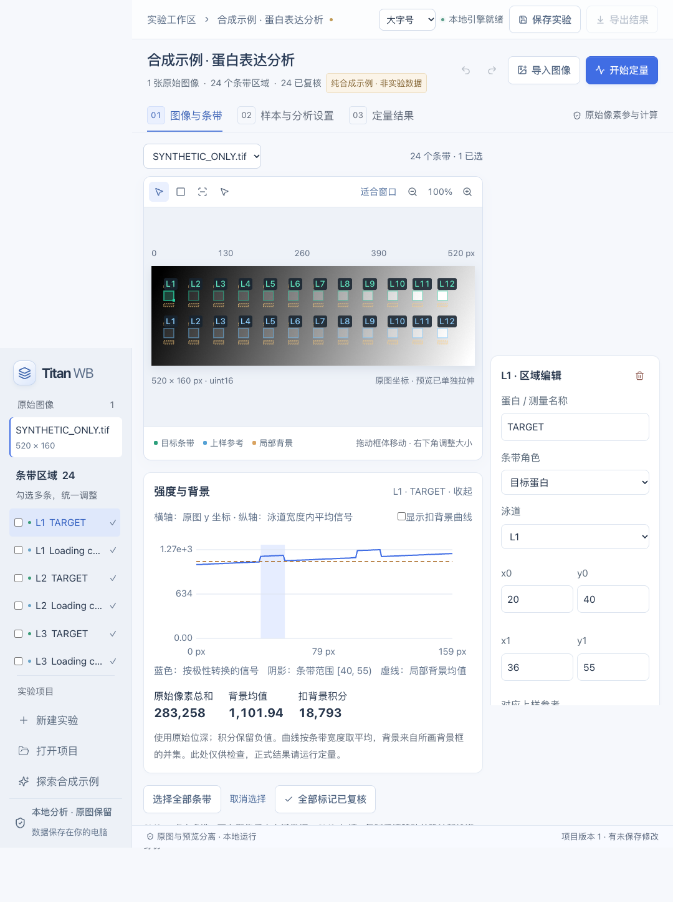

# Titan WB

[](https://github.com/Goodoweswin/Titan/actions/workflows/ci.yml)
[](LICENSE)

本地运行的 Western blot 图像定量桌面工具。使用 React / TypeScript 构建界面，Tauri 提供桌面能力，Python 负责原始像素定量与统计。

**当前状态：测试版。** 已有自动化测试和合成数据验证；真实 WB 定量准确性与完整原生桌面操作验收仍待完成。适合试用、方法核对和共同改进。它不能自动判断抗体特异性、曝光线性或实验设计是否有效。

## 下载与安装

前往 **[GitHub Releases](https://github.com/Goodoweswin/Titan/releases)** 下载预发布版本：

| 系统 | 下载文件 | 安装方式 |
| --- | --- | --- |
| macOS 14+，Apple Silicon（M 系列） | `*-macos-arm64.dmg` | 打开磁盘映像，将 Titan WB 拖入 Applications |
| Windows 10/11，x64 | `*-windows-x64-setup.exe` | 运行安装向导，支持中文 |

安装包包含 Python 计算引擎。Windows 缺少 WebView2 时会联网安装该运行库。当前未提供 Intel Mac、Windows ARM 或 Linux 安装包；macOS 包采用临时签名，尚未完成 Apple 公证，Windows 包未配置商业签名。

发布页面提供 `SHA256SUMS.txt` 和第三方许可归档。正式发布资产与短期保留的 Actions 构建产物分别管理。



## 主要能力

- 导入单通道 TIFF / PNG，保留原始位深；显示预览与定量数据分离。
- 手动画框、批量编辑与撤销；自动识别候选先预览，确认后加入项目。
- 原图、ROI、泳道强度曲线及局部背景联动，扣背景积分保留负值。
- 样本、技术重复、生物学重复、参考条带与跨膜 IBC 显式映射。
- 参考归一化、分块生物学汇总、受限两组统计与质量提示。
- `.titanwb` 项目保存与重开；导出 CSV、JSON、PNG、SVG、原图、标注与审计记录。
- 图表导出预览，可设尺寸、字号和 DPI；浅色界面支持大字号。

完整操作流程见 **[使用指南](docs/USER_GUIDE.md)**。软件内「体验合成示例」和仓库中的示例均为生成数据，标注为非实验数据。

## 开发

需要 Python 3.11、Node.js 22、Rust stable，以及目标平台的 Tauri 编译工具链。Mac 需要 Xcode 命令行工具；Windows 需要 Visual Studio C++ 桌面开发组件与 Windows SDK。

```bash
git clone https://github.com/Goodoweswin/Titan.git
cd Titan
python3.11 -m venv .venv
.venv/bin/python -m pip install -r requirements.lock
npm ci
mkdir -p artifacts
cargo metadata --manifest-path src-tauri/Cargo.toml --format-version 1 > artifacts/cargo-metadata.json
.venv/bin/python scripts/collect_notices.py
.venv/bin/python packaging/build_engine.py
npm run desktop:dev
```

Windows 使用 `.venv\Scripts\python.exe`。一键构建步骤见 [Windows 构建指南](docs/WINDOWS_BUILD.md)。

```bash
npm test
.venv/bin/python -m pytest -q
npm run build
npx playwright install chromium
npm run test:e2e
```

## 构建 macOS 安装包

先生成第三方声明和原生 Python 引擎，再构建 Tauri：

```bash
mkdir -p artifacts
cargo metadata --manifest-path src-tauri/Cargo.toml --format-version 1 > artifacts/cargo-metadata.json
.venv/bin/python scripts/collect_notices.py
.venv/bin/python packaging/build_engine.py
npm run desktop:build
```

安装包位于 `src-tauri/target/release/bundle/`。使用 `scripts/verify_release.py` 可在独立副本和受限 PATH 下验证打包引擎；它不自动验证原生窗口操作。CI 在 Windows x64 和 macOS arm64 原生环境构建；版本标签 `v*` 触发双平台预发布流程。

## 文档与参与

- [贡献指南](CONTRIBUTING.md) · [问题反馈](https://github.com/Goodoweswin/Titan/issues) · [安全报告](SECURITY.md)
- [版本记录](CHANGELOG.md) · [发布验证记录](docs/releases/v0.1.0-beta.2-verification.json) · [待办与验证重点](docs/ROADMAP.md)
- [原生验收清单](docs/NATIVE_ACCEPTANCE.md) · [验证记录索引](docs/checkpoints.md)
- [第三方许可](docs/THIRD_PARTY_NOTICES.md) · [研究资料与独立参考实现](wb_research/README.md)
- 历史设计、实施计划和检查点保留于 `docs/`，其中部分内容描述早期版本，不代表当前已实现或已验证的能力。

## 许可

Titan WB 原创代码与项目文档采用 [MIT License](LICENSE)。第三方依赖保留各自许可证；许可清单由发布环境生成，并随发布包附带。
