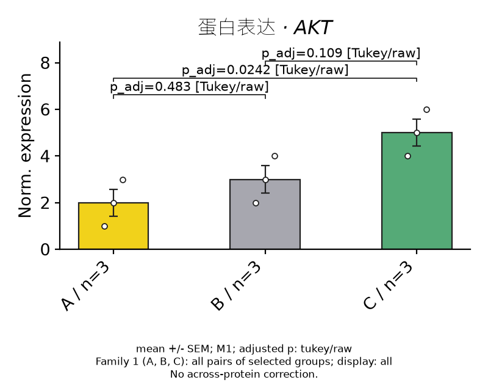

# 0.3.0 论文图、多组统计与项目左栏

2026-11-01。已按用户批准方案完成并保留本地更新包，**未安装、未退出或重启正在运行的应用**。0.2.1 的既有 ZIP 哈希复核未变。本轮在隔离工作树开发，没有修改用户项目或原源码工作目录的受版本控制文件。

新实验立即写入本机项目库，空闲约1.5秒自动保存；支持手动保存、另存自选位置。左栏可搜索、展开项目，打开工作台、结果或正式图表。同科学ID的副本按路径分别登记，移动后可重新定位。保存/切换失败保留修改，迟到的保存、预览和历史图响应不能接管新项目或新页面。

结果页支持均值柱＋空心原始点、纯柱或散点＋均值；各组颜色/HEX、显示名称/顺序、标题、轴、点、柱宽、间距、线宽、尺寸和字体均可调整，默认黄/灰。SD、SEM、每组均值t区间分别解释；未确认独立设计时只展示泳道，不自动生成生物学n。普通预览不产生版本，首次正式图、手动变体和成功导出图可从左栏回找。图形冻结生成时的数据；重设样式与明确更新源分开，旧版本保留。导出归档记录目的路径和PNG SHA256，并验证归档图与实际导出一致。

独立单因素、三个及以上组：普通ANOVA后Dunnett对照或Tukey全两两；Welch ANOVA后Games–Howell。只显示Games–Howell对照组对时仍保留全两两家族。旧两组Holm家族独立保留。统计使用归一化生物学单位，可明确选择正值log2；总体p、组对调整p、同时CI、家族、SciPy版本和Dunnett数值积分种子/近似说明可追溯。方法说明参考[GraphPad Tukey与Dunnett](https://www.graphpad.com/guides/prism/latest/statistics/stat_the_methods_of_tukey_and_dunne.htm)及[SciPy1.17.1多重比较接口](https://docs.scipy.org/doc/scipy-1.17.1/reference/generated/scipy.stats.tukey_hsd.html)。不声称实现完整Prism或已获Prism逐项实机对照。

Excel现有12表，增加分组描述、总体检验和多重比较；保留原始测量、参考归一化、缺失状态和来源。实际渲染配置写入导出project.json/说明/审计。预览、PNG/SVG、Excel嵌图和归档使用同一渲染器；独立图注保留倍数分母不确定性、组对家族/显示范围及不跨蛋白校正说明。中文字体和OFL许可随包离线提供。

## 验证

| 范围 | 结果 |
|---|---|
| 完整Python | 174 tests + 5 subtests 通过 |
| 最后图注/历史/Excel专项 | 45通过；版本/积分溯源专项31通过 |
| 前端单元 | 53通过 |
| Rust | 6通过，main/doctests为0用例 |
| 浏览器＋实际Python | 26通过，含标准/大字号、窄窗口、三组方法/标记、草稿取消及迟到响应 |
| TypeScript/Vite、PyInstaller、Tauri App | 通过 |
| 独立复制App、清空PATH | 24测量、12目标、6生物学单位；保存、重开、导出通过 |
| 打包泳道夹具 | 48000原积分，32000目标净积分/8000参考净积分=4；缺失为空；8/16位压缩MINISWHITE原像素检查通过 |
| 打包三组手算夹具 | A=[1,2,3]、B=[2,3,4]、C=[4,5,6]；普通F(2,6)=7、p=.027；Welch F(2,4)=6、p=.0625 |
| 图与表 | 预览PNG、导出PNG、Excel嵌图字节相同；12工作表可重读，实际配置相同 |
| 图形历史与副本 | 冻结源、重设样式、历史携带原图、移除原位置后副本加载通过 |
| App及ZIP解压 | 严格签名通过；解压引擎版本0.3.0、probe净积分80；ad-hoc签名，未公证 |

一次独立只读复核发现2个Important：历史响应可覆盖已切换页面、独立图注漏掉统计限定。分别以延迟加载和图注测试复现失败后修复；Dunnett积分溯源Minor也已补齐，未请求第二轮复核。细节见[review.json](publication-library/review.json)。

机器证据：[通用打包检查](publication-library/bundle-verification.json)、[泳道夹具](publication-library/lane-verification.json)、[三组/项目库/导出](publication-library/publication-verification.json)、[包哈希与安装状态](publication-library/package.json)。

## 保留文件与边界

- App：`release/publication-library/Titan WB 0.3.0.app`
- ZIP：`release/publication-library/Titan-WB-0.3.0-macos-arm64.zip`，74,003,961字节。
- SHA256：`8b4b79251d1bc42f060558cc37c1c071cb14a551e144cd17abb02df70023915d`，同目录附`SHA256SUMS.txt`。
- 对应产品源码/验证脚本提交：`07aa097`。无push、发布、合并或安装操作。

当前验证为合成数值、格式、源代码和Mac打包引擎检查。没有把原生窗口、Microsoft Excel/矢量软件实开、真实WB科学准确性、独立Fiji/Prism对照或Windows原生验收标为通过；新原生窗口清单见[NATIVE_ACCEPTANCE.md](../NATIVE_ACCEPTANCE.md)。用户指南见[USER_GUIDE.md](../USER_GUIDE.md)。
