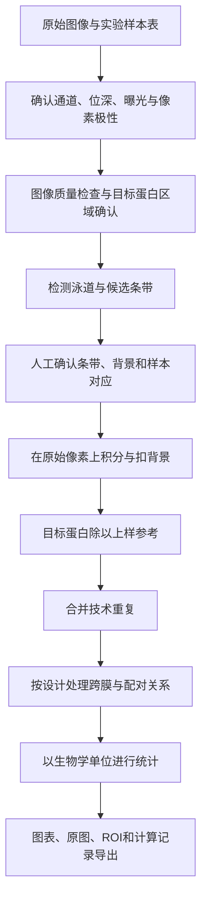

# Western blot 数据分析：protocol、公式与 App 研发资料

整理日期：2026-10-21。本文将 WB 理解为 Western blot（蛋白免疫印迹）。

用户已确认输入为原始 WB 图像（TIFF/PNG）。以下流程以这些图像为入口。

交付范围：常规膜式 WB 的图像定量、归一化、重复层级、统计设计、自动化算法和研发验证。毛细管 WB 的仪器峰数据、质谱数据、临床诊断阈值需要另行设计。

**标记说明**：带链接的科学结论来自所列一手资料；“建议”“参考实现”属于本次面向 App 的技术综合，不代表统一行业标准。附带代码是可以运行的教学基线；尚无用户真实 WB 数据上的准确性验证。

## 1. 需要自动化的完整流程



WB 图像提供相对信号。只有抗体特异性、实验响应和检测范围经过验证，灰度比值才有可靠的相对定量含义；单凭软件产生了数字，不能证明其反映真实蛋白变化。[Janes 2015：定量 immunoblot 的关键因素](https://pubmed.ncbi.nlm.nih.gov/25852189/)

**我的研发建议**：首版优先支持“原始灰度 TIFF/PNG → 候选框 → 用户确认 → 可追溯定量”。样本身份、目标蛋白身份、内参是否适用应由实验记录确认；图像模型负责提出候选。

## 2. 上游实验必须向分析端提供什么

下面是实验信息清单，不是适用于所有蛋白的湿实验配方。裂解液、胶浓度、上样量、转膜条件、封闭液和抗体稀释需要依目标与设备优化。LICOR 的原厂 protocol 可作为实验阶段的流程入口。[原厂定量 WB workflow](https://www.licorbio.com/applications/quantitative-western-blots/workflow)

| 阶段 | 需要记录 | 对 App 分析的影响 |
|---|---|---|
| 实验设计 | 分组、动物/供者/独立培养编号、配对关系、处理、批次 | 决定真正的 n 和统计单位 |
| 蛋白提取 | 样本来源、裂解条件、定量方法、是否检测修饰 | 避免把样本制备差异当表达差异 |
| 上样、电泳 | 每泳道样本、上样量、胶类型、marker、泳道顺序 | 建立 sample–lane 映射 |
| 转膜 | membrane_id、转膜批次、是否切膜、总蛋白图 | 确认目标和参考是否对应同一原始泳道 |
| 抗体检测 | 抗体标识/批次、目标、预期分子量、阳性/阴性验证 | 不能仅凭最深条带认定目标 |
| 成像 | 仪器、检测方式、曝光、增益、通道、有效动态范围 | 判断像素能否被用于定量 |
| 洗脱复染 | 顺序、轮次、配准关系、可能残留与损失 | 需要单独评估复染的可比性 |

不要把“固定上样 20 μg”“某个曝光秒数”“GAPDH 一定不变”写成所有实验的默认 protocol。2013 年的验证研究强调，抗体对应的样本稀释与线性响应需要先确定。[Taylor 等，2013](https://pubmed.ncbi.nlm.nih.gov/23709336/)

### 建议的数据层级

```text
study
  └─ biological_unit：一只动物、一个供者或独立实验单位
       └─ sample：该单位在某条件/时间点的样本
            └─ aliquot / technical replicate
                 └─ membrane + original_lane
                      └─ acquisition：通道 + 曝光 + 原始图像
                           └─ ROI + 背景 + 测量 + 版本
```

同一动物的多个泳道不能自动变成多个动物；同一膜的多个曝光也不能算多个生物学重复。配对条件中的同一单位应保留相同 `bio_id`，并用不同 `sample_id` 区分条件样本。

## 3. Protocol A：矩形 ROI 积分，最适合首版研发

这是建议先实现的基线，因为每一步都容易解释，也方便与 Fiji 的原始像素测量对照。

### A1. 导入原始图

1. 尽量使用成像仪导出的原始、未裁切、未做非线性调整的灰度数据。
2. 记录文件 hash、尺寸、像素类型、通道与曝光。
3. 有 16 位原图时保留原位深。为了屏幕显示生成的 8 位预览不能替换定量数据。
4. RGB 合成图先明确真实检测通道；不要默认把彩色荧光图转成一个灰度通道。
5. JPEG、截图、论文拼图可以导入作探索，但应标注来源与量化限制。
6. 明确亮条带/暗条带是实际像素极性，还是显示 LUT 的效果。

**参考代码约束**：仅直接读取单平面灰度 TIFF/PNG 等 Pillow 可读格式；拒绝 RGB、调色板、多页图和存在极性歧义的 TIFF。对于多通道原始文件，需增加显式选通道与导出校验。

### A2. 确认目标区域与泳道

用户根据实验记录、marker、抗体验证和预期分子量指定候选区域，检查是否存在非特异条带、双带、降解片段或拖尾。自动检测结果必须能增、删、移动与重新映射样本。

建议同一目标的各泳道先采用一致大小的矩形 ROI，完整包含目标信号并避免邻带。弯曲条带可以移动 ROI 或采用独立的泳道轨迹；不要为了让某个结果更显著而逐泳道改变边界规则。

如果研究对象本来是多种剪切体、多个修饰形式或泛素化 smear，应先定义终点：指定条带、条带之和、某个区域的总积分，或多个终点分别报告。选择规则需在比较组间结果前确定。

### A3. 定义局部背景

每条带选择相邻、同一局部背景条件、没有其他条带或明显污点的背景框。可以选上、下两个框，必要时用局部平面拟合处理背景梯度。背景区域不必与条带面积相同，但必须按条带面积缩放扣除。

不要把“条带框以外所有像素”一概当背景。它们可能包含其他蛋白、marker、边缘或污染。ROI 与背景应显示在 overlay 中，并一起导出。

### A4. 测量与公式

令原始像素为 `I(x,y)`，定义信号朝正方向的数值 `S(x,y)`：

```text
亮条带：S = I
暗条带：S = C − I
```

`C` 是已确认的图像编码上界/反相常数，不能用当前图像的最大像素替代。16 位文件也可能保存 12 位有效采集范围，是否为 4095、65535 或其他尺度应查元数据。

对于条带 ROI 的像素集合 Ω、像素数 A，以及背景像素集合 B：

```text
raw_integrated_density = Σ I(x,y), (x,y) ∈ Ω
oriented_integral      = Σ S(x,y), (x,y) ∈ Ω
background_mean        = mean(S(x,y)), (x,y) ∈ B
corrected_signal       = oriented_integral − A × background_mean
```

**手算例**：4 个条带像素的数值均为 30，背景均值为 10，则净信号 `4×30−4×10=80`。若背景均值高于条带均值，保留负数，并标记低于有效信号范围，不能先逐像素截成零再求和。

ImageJ 的原始积分法也有公开示例，可以用来理解“背景扣除后测积分”的基本操作。[ImageJ 官方 Dot Blot 示例](https://imagej.net/ij/docs/examples/dot-blot/index.html)

### A5. 不要混淆以下数字

| 数字 | 含义 | 使用边界 |
|---|---|---|
| Area | ROI 面积 | 不能单独代表蛋白量 |
| Mean | 框内平均像素 | ROI 面积变化时不能直接代替总信号 |
| RawIntDen/原始像素积分 | 像素总和 | 含背景，需要说明扣背景 |
| 背景校正积分 | 条带净信号 | 仍需上样参考和实验范围验证 |
| 峰面积 | 泳道曲线上相对基线积分 | 依赖曲线、基线和峰边界定义 |
| %Area | 相对于所选峰总和的比例 | 不能直接等同 target/loading-control 比值 |

## 4. Protocol B：ImageJ/Fiji 泳道曲线与峰面积

适合人工审核、探索多峰和与已有实验室流程比较：

1. 用矩形框选择第一条泳道，`Analyze > Gels > Select First Lane`。
2. 移动相同矩形，逐条 `Select Next Lane`。
3. `Plot Lanes` 生成泳道曲线。
4. 为目标峰定义基线、峰的左右边界；人工方法通常以线工具闭合峰区，再用 Wand 测峰面积。
5. 保存泳道 ROI、基线和原始曲线，再做对应参考归一化。

这是 ImageJ 官方说明中的传统 gel 分析路线。[ImageJ Gels 文档](https://imagej.net/ij/docs/menus/analyze.html#gels)

开发时可以将泳道横向像素求和，得到纵向曲线 `P(y)=Σx S(x,y)`，再计算指定 y 区间内的基线校正和。如果取“横向均值”曲线，需记录泳道宽度；宽度不同会改变它与二维总积分的关系。

**建议**：直接对数值曲线积分，别对截图中的曲线轮廓进行二次图像测量。二维 ROI 与一维峰法只有在像素范围、横向求和/求均值方式、基线和积分区间一致时才可期望对应。

## 5. Protocol C：局部/滚动背景与全自动分割

### 背景算法怎么选

| 方法 | 适合的起点 | 常见失败 | 建议 |
|---|---|---|---|
| 显式局部背景均值 | 背景平缓、邻近有干净区域 | 污点或邻带污染背景 | 首版默认，保留背景框 |
| 局部中位数 | 少量异常背景像素 | 与均值法数值不同 | 作为独立可选方法记录 |
| 局部平面/曲面 | 存在缓慢背景梯度 | 区域选择偏差、拟合跨过真实信号 | 用模拟梯度和空白区验证 |
| 泳道一维基线 | 多条带泳道 | 把弱峰视为基线 | 保存每条基线及参数 |
| rolling ball / paraboloid | 缓慢变化的二维背景 | 尺度过小吞掉宽带/拖尾 | 按信号尺度验证参数 |

ImageJ 有正式的 `Subtract Background` 算法说明；半径和图像信号空间尺度有关，不能为所有图像固定一个“万能半径”。[ImageJ Process 文档](https://imagej.net/ij/docs/menus/process.html#background)

**一致性规则**：若已扣除背景图 `B(x,y)`，下游积分应清楚使用 `Σ(I−B)`。不要在不知情时再用局部背景扣一次。展示、检测、定量三种图像的处理记录分别保存。

### 自动化的三个层次——本次研发建议

| 层次 | 实现 | 价值 | 限制 |
|---|---|---|---|
| 辅助定量 | 用户确认泳道/ROI后批量计算 | 容易校验，先建立可信基线 | 仍需要少量框选 |
| 经典候选检测 | 局部背景、投影、峰检测、连通域 | 无需训练，适合规整图 | 弱条带、邻带、拖尾容易失败 |
| 学习式分割 | U-Net 等输出条带 mask | 更适合不规则条带 | 需要域外测试、人工纠错和定量验证 |

GelGenie 的论文展示了基于像素分割的 gel 条带分析，公开了标注数据和模型。它是很好的算法起点，但论文中的 gel 数据表现不能直接视为你实验室 WB、全部曝光条件和所有检测方式的性能保证。[GelGenie 论文](https://www.nature.com/articles/s41467-025-59189-0)

附带参考检测器只在用户指定的目标 y 区间提议 x 方向条带框，使用上下邻域估计每一列的背景。它不会自动认定蛋白身份、分子量、样本顺序或可定量曝光。其阈值 0.25 是演示参数，需要在真实数据上验证。

## 6. 归一化：必须区分三个层面

### 6.1 上样参考校正

```text
N_i = corrected_target_i / corrected_reference_i
```

参考可以是经过验证稳定的 housekeeping protein，或同膜对应泳道、规定区域的总蛋白信号。target 与 reference 应分别扣背景，显式对应同一个原始样本/泳道；独立成像时可以有不同 ROI 尺寸与曝光，前提是各自响应已验证，跨膜解释还需校准。

| 方案 | 需要回答的问题 |
|---|---|
| GAPDH、β-actin、Tubulin 等 | 是否会被处理改变？是否饱和？是否对应同一泳道？ |
| 总蛋白参考 | 染色/成像响应是否可靠？使用哪段泳道？是否排除marker？ |
| 细胞器/分馏参考 | 研究问题是每总蛋白、每细胞，还是每分馏的含量？ |

Bio-Rad 的分析指南说明了以参考信号进行归一化的用途。App 应允许明确选择方案，而不是自动认定某个 housekeeping protein 永远稳定。[Bio-Rad 数据分析指南](https://www.bio-rad-antibodies.com/western-blotting-data-quantitation-normalization-densitometers-analysis-software.html)

分母为零、净信号非正或参考被确认饱和时，不加入任意 epsilon 继续算比例；应保留原测量并标记不可用。非正目标信号也不能直接进入 log 转换。

### 6.2 相对对照表达

在可比较的同一分析块内，以生物学单位为等权重计算对照均值：

```text
F_i = N_i / mean(N_controls)
```

比如对照的 N 为 `0.8, 1.0, 1.2`，处理为 `1.6, 2.0, 2.4`，则对照均值为 1，处理均值为 2。对照的每个点仍为 `0.8, 1.0, 1.2`，保留组内变异。

若每个实验只放一条对照泳道，用它作分母会让该实验对照点恒为 1。不能因此对对照组绘制“零变异”并按独立两组 t 检验解释；应保留原始比值、实验块或配对关系，按研究设计建模。

归一化会引入共享分母及数据相关性，弱参考还会放大噪声；这在 Degasperi 等的研究中有明确讨论。[归一化策略的统计影响，2014](https://journals.plos.org/plosone/article?id=10.1371/journal.pone.0087293)

### 6.3 跨膜桥接

多膜实验建议预先安排共同 pooled reference / interblot control（IBC），再进行：

```text
N_sample = target_sample / reference_sample
N_IBC    = target_IBC / reference_IBC
R_sample = N_sample / N_IBC
```

共同参考需在各膜上测量并处于已验证范围。不同膜分别“对照=1”可以帮助某些同膜设计下的相对比较，但不会自动消除批次混杂。尤其“对照全在膜A、处理全在膜B”不能靠数学归一化恢复无混杂的处理效应。

2022 年的定量 WB workflow 对同膜参考与跨膜 IBC 分层计算给出了示例，Fig. 4 及其 Excel 补充表值得直接阅读；其示意数据不应当作训练集或真实生物学效应。[Taylor 等，2022 PDF](https://www.nature.com/articles/s41598-022-22294-x.pdf)

**代码范围**：本次实现同膜比例和同膜对照汇总；不自动合并多膜，也未实现 IBC 校准。需要在真实项目中明确共同参考及批次设计后再扩展。

## 7. 磷酸化蛋白、总蛋白与 double normalization

先区分问题：

```text
磷酸化相关终点：corrected_phospho / corrected_total_target
总蛋白丰度终点：corrected_total_target / corrected_loading_reference
```

`pAKT/AKT` 与 `AKT/总蛋白`回答不同问题，建议作为独立终点保存。前者通常只能称为相对磷酸化信号比例，不能在缺乏相应校准时解释为真实磷酸化占有率。

若先计算 `p/loading` 和 `total/loading`，两者再相除，同一 loading 数学上会约掉；不要在已经得到的 `p/total` 上不加判断地再除一次 loading。洗脱复染、独立膜、不同抗体响应与配准误差仍需实验验证。

## 8. 统计流程

以下是面向本 App 的统计设计建议，不能把一张图里的“泳道数”直接当作独立样本数。

1. 每条技术测量先完成相同定义的背景校正与参考归一化。
2. 明确技术重复合并规则；基线代码取同膜、同终点、同生物学单位、同组内的技术比值均值。
3. 生物学单位进入统计；同一单位的重复时间点/条件保留配对关系。
4. 检查效应尺度、异常值原因、实验块与设计；正值比例可考虑 log2 尺度，但不是强制。
5. 按设计选模型。不要以小样本 Shapiro–Wilk 的一次结果自动决定全部检验。
6. 多终点/多比较报告所用校正策略；保留完整结果，不能只导出显著条目。

| 设计 | 可考虑的分析 | 必须注意 |
|---|---|---|
| 两组独立生物学样本 | Welch t、合适的线性模型，或设计匹配的稳健方法 | 输入为独立单位，不是技术泳道 |
| 同一动物前后/匹配处理 | 配对分析、含单位效应的模型 | 匹配必须来自实验设计 |
| 多组与多膜 | 含组别和膜/实验块项的模型 | 完全混杂无法靠模型解决 |
| 多时间点/重复测量 | 重复测量或混合模型 | 同一单位的值相关 |
| 每次实验只有一个对应对照 | 每块内对比、log比值或配对模型 | 对照恒1不能当有零方差的独立组 |

图表建议以生物学散点为主，配对时连线，标明 n、效应和区间。SD 描述单位间变异，SEM 描述均值估计精度，两者要明确标注。样本量应依变异与效应设计，不能把“n=3”做成所有实验的充分标准。

基线代码只给描述性汇总，不擅自选检验、计算 p 值或显著性星号。

## 9. 质量控制规则

下面是建议实现的状态规则；数值阈值需实验验证，不是已存在的通用标准。

| 事件 | 建议行为 |
|---|---|
| 来源为截图/拼图/有损压缩 | 警示来源，限制定量结论 |
| 未知像素极性、通道或有效编码范围 | 请求确认；不猜测ADC范围 |
| 目标或参考存在信号端 clipping | 标记，阻止其进入默认归一化 |
| 无 clipping 但未验证线性范围 | 允许探索性结果，显示未验证状态 |
| 目标区域有气泡、污点、强拖尾、邻带重叠 | 人工判断、重新定义终点或排除并记原因 |
| ROI 越界或与背景重叠 | 拒绝计算 |
| 匹配的参考样本/泳道不一致 | 拒绝归一化 |
| 背景后净信号 ≤0 | 保留数值，阻止比例/log计算 |
| 参考弱、背景复杂、边界选择影响大 | 标记并检查方法敏感性 |
| 无法连接的多膜或分组与膜混杂 | 暂停跨膜合并 |

饱和分两件事：数字图像到达编码端点；以及抗体、膜、底物或检测链的响应已非线性。前者可以检查像素端点，后者需要稀释/响应实验。BlotTool 的作者也明确提醒，其 saturation flag 本身不能证明线性范围。[BlotTool 的限制说明](https://github.com/matthew-sanders5/blottool)

**曝光规则建议**：同一目标、同一可比较图像块优先使用一幅适合所有相关条带且经验证的图像。不要为每条泳道任意选“最好看”的不同曝光；ECL 还有反应时程因素，不能未经验证就除以曝光秒数混合。

## 10. App 的最小数据结构

| 实体 | 核心字段 |
|---|---|
| Sample | sample_id、bio_id、group、condition、pair_id |
| MembraneLane | membrane_id、original_lane_id、sample_id、切膜/复染记录 |
| Acquisition | image_id、hash、dtype、channel、exposure、gain、polarity、编码范围 |
| Endpoint | analyte、expected_mw、条带/区域选择规则、normalization_method |
| ROI | 坐标/mask、坐标系、图像变换、创建者、复核者、版本 |
| Measurement | 原积分、背景、面积、净积分、QC、软件/参数版本 |
| Analysis | reference_id、control_set、技术重复规则、统计模型、排除原因 |

建议保留从“一个图上的点”回到“原始文件 + 原始泳道 + ROI + 背景 + 计算版本”的完整路径。移动 ROI、换图或改样本顺序后，要使相应下游结果失效并重算。

裁切/旋转若用于显示与检测，应保留到原图坐标的变换。定量优先在原始像素坐标上执行，避免随意插值改变积分。正式原图、展示拼图和图表分别导出。

## 11. 怎么验证 App 是否可信

### 第一层：数值正确

用已知背景/强度的合成图，检查净积分、位深、极性、ADC端点、负值、零分母、图像边界和技术重复权重。本次附带这些检查，但合成图只能验证实现行为。

### 第二层：人工对照

同一批真实原图，由熟悉实验者保存目标/背景 ROI，与 Fiji 原像素积分法比较。在尽量一致的 ROI 与背景定义下检查数值差异；有基线/边界差异时应先定位定义，而不是只比较最后的 p 值。

建议报告：配对偏差、绝对/相对误差、Bland–Altman 图、重复标注一致性。相关性高仍可能存在系统偏差。接近零的参考信号不适合用普通百分比误差作唯一指标。

### 第三层：实验可定量性

使用真实样本稀释系列与预先设定的混合/比例实验，检查目标与参考的响应范围及能否恢复已知比例。R² 不是唯一证据，还应看残差、低端噪声、饱和与回收偏差。

### 第四层：自动识别的泛化

测试集按原膜/完整实验分开；同一膜的裁剪、通道和曝光应在同一分区，避免泄漏。保留独立仪器/实验室测试。分别报告条带漏检、错检、泳道归属错误、定量误差、人工修改次数与失败案例。

Dice/IoU 好，不保证净积分、归一化效应和样本匹配正确。GelGenie 提供的公开 gel 数据可用于熟悉分割管线，WB 的实验终点仍需自己的验证集。

## 12. 推荐的研发顺序

以下为建议，不是已经获得用户确认的产品需求：

1. **可审核的定量核心**：原图导入、显式ROI/背景、样本映射、QC、原始数据导出。
2. **半自动候选与纠错**：限定目标区域的检测、统一框规则、拖动纠正、映射确认。
3. **参考与重复管理**：支持内参/总蛋白、配对关系、技术重复和同膜描述性汇总。
4. **多膜与统计**：明确IBC、批次与设计后增加跨膜和统计模块。
5. **学习式识别**：达到真实数据验证要求后，才扩大默认自动化范围。

选用哪种前端、是否做桌面端、是否本地处理、是否支持仪器专有文件，应在正式构建 App 前结合实际输入另行确定。本次附带的代码可帮助先验证定量逻辑。
